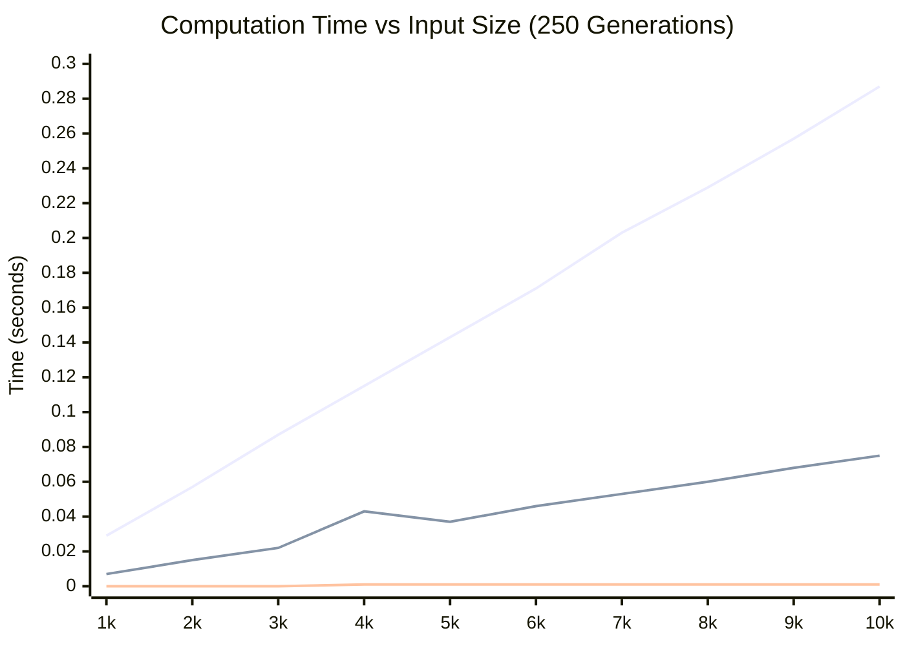

# Conway's Game of Life

This project is a high-performance C++ implementation of Conway's Game of Life, exploring various optimization and parallelization techniques. It includes the baseline without bitboards, sequential versions, bitboard optimizations, and parallel implementations using OpenMP, and CUDA.

Demo available at https://cahya-wirawan.github.io/game-of-life/

## Project Overview

Conway's Game of Life is a cellular automaton devised by John Conway in 1970. The game consists of a grid of cells, each being either alive or dead. The state of the grid evolves in discrete time steps (generations) according to a set of simple rules based on the state of neighboring cells.

### Rules
1.  **Underpopulation**: A live cell with fewer than 2 live neighbors dies.
2.  **Survival**: A live cell with 2 or 3 live neighbors lives on.
3.  **Overpopulation**: A live cell with more than 3 live neighbors dies.
4.  **Reproduction**: A dead cell with exactly 3 live neighbors becomes a live cell.

The grid uses **wrap-around** (toroidal) boundary conditions.

## Implementations

This repository contains multiple variations of the simulation to demonstrate different performance characteristics:


| Executable | Description | Key Technologies |
| :--- | :--- | :--- |
| `gol-baseline` | Reference sequential implementation | C++ |
| `gol` | Optimized implementation using Bitboards (64 cells per word) parallelized with OpenMP | Bitwise Operations, Bitboards, OpenMP |
| `gol-cuda` | Bitboard implementation accelerated with CUDA | CUDA, Bitboards |

*(Note: Some targets like `gol-cuda` require an NVIDIA GPU and CUDA Toolkit)*

## Building

A `Makefile` is provided to compile the project.

To build all available targets:
```bash
make
```

To build a specific target (e.g., `gol-baseline`):
```bash
make gol-baseline
```

To clean build artifacts:
```bash
make clean
```

## Usage

All executables share a common command-line interface.

### General Syntax
```bash
./<executable> --load <input_file> --save <output_file> --generations <n> [--measure] [options]
```

### Arguments
-   `--load <file>`: Path to the input file containing the initial board state.
-   `--save <file>`: Path to the output file where the final state will be saved.
-   `--generations <n>`: Number of generations to simulate.
-   `--measure`: (Optional) measure and print execution time to `stdout`.

### specific Options (for `*-mp` versions)
-   `--threads <n>`: Number of threads to use (default: 1).
-   `--mode <omp|seq>`: Execution mode (default: `omp`).

### Examples

**Run reference implementation:**
```bash
./gol-baseline --load inputs/random1000.gol --save output.gol --generations 250 --measure
```

**Run Bitboard + OpenMP version with 4 threads:**
```bash
./gol --load inputs/random1000.gol --save output.gol --generations 250 --measure --threads 4 --mode omp
```

## File Formats

### Input/Output File (`.gol`)
The file format is simple text:
1.  **Header**: `<columns>,<rows>` (e.g., `100,100`)
2.  **Grid**: Rows of characters where:
    -   `x` represents a **live** cell.
    -   `.` represents a **dead** cell.

**Example:**
```text
5,5
.....
..x..
..x..
..x..
.....
```

### Measurement Output
If `--measure` is enabled, the program outputs timing information to `stdout` in the following format:
```text
MM:SS.mmm;MM:SS.mmm;MM:SS.mmm
```
Fields: `Setup Time ; Computation Time ; Finalization Time`

## Benchmarking

A `benchmark.sh` script is included to automate testing across different implementations and input sizes.

### Benchmark Results (250 Generations)

The following results demonstrate the performance scaling of different implementations for 250 generations. The input files range from 1000x1000 to 1000x10000 cells.

| Input Size | Baseline (No Bitboard) | Sequential (Bitboard) | OpenMP (4 Threads) | CUDA (GPU) |
| :--- | :---: | :---: | :---: | :---: |
| 1000x1000 | 3.908s | 0.029s | 0.007s | 0.000s |
| 1000x2000 | 7.811s | 0.057s | 0.015s | 0.000s |
| 1000x3000 | 11.707s | 0.087s | 0.022s | 0.000s |
| 1000x4000 | 15.622s | 0.115s | 0.043s | 0.001s |
| 1000x5000 | 19.520s | 0.143s | 0.037s | 0.001s |
| 1000x6000 | 23.462s | 0.171s | 0.046s | 0.001s |
| 1000x7000 | 27.458s | 0.203s | 0.053s | 0.001s |
| 1000x8000 | 31.294s | 0.229s | 0.060s | 0.001s |
| 1000x9000 | 35.202s | 0.257s | 0.068s | 0.001s |
| 1000x10000 | 39.092s | 0.287s | 0.075s | 0.001s |

*(Times shown are for the **computation phase** only)*

### Hardware Specifications

The benchmarks were performed on a system with the following specifications:
- **CPU**: Intel(R) Core(TM) i3-10100 CPU @ 3.60GHz
- **GPU**: NVIDIA GeForce RTX 3090 (24GB VRAM)
- **RAM**: 64GB
- **OS**: Ubuntu 22.04.4 LTS
- **CUDA Version**: 12.6

### Performance Chart

**Note:** The Baseline implementation is excluded from the chart below as its execution time is orders of magnitude higher (reaching ~39s), which would distort the scale for the optimized implementations.


*Legend: Top line (Sequential Bitboard), Middle line (OpenMP), Bottom line (CUDA)*

### Author
*Cahya Wirawan*

